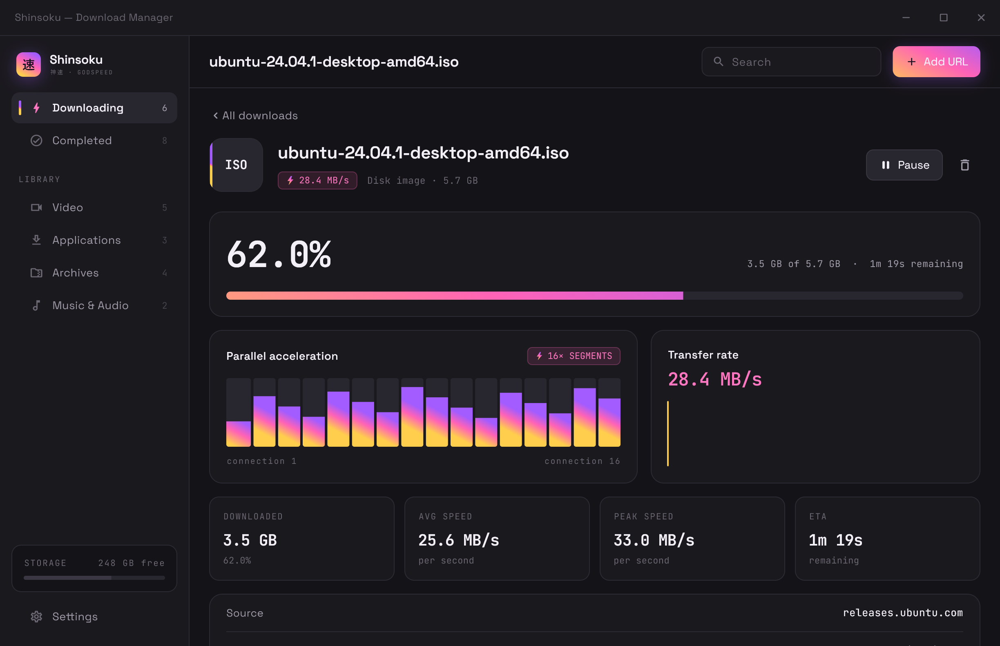
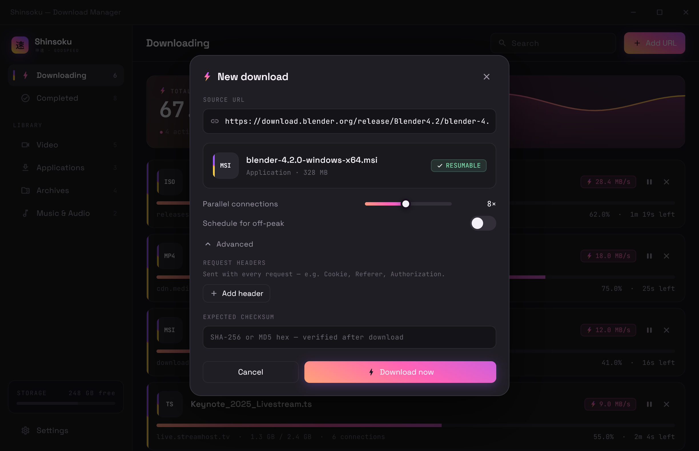
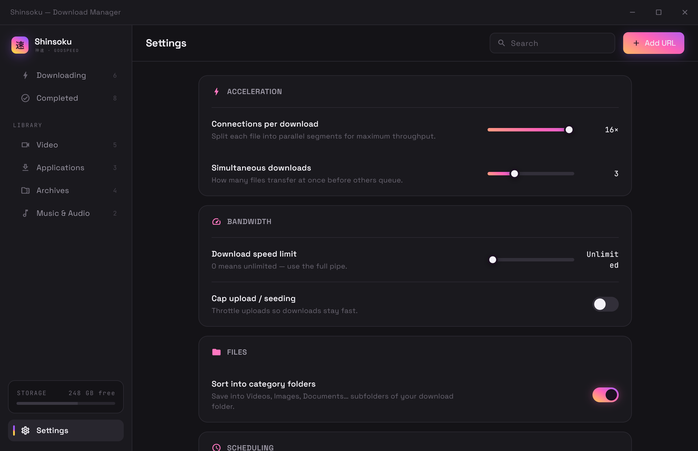
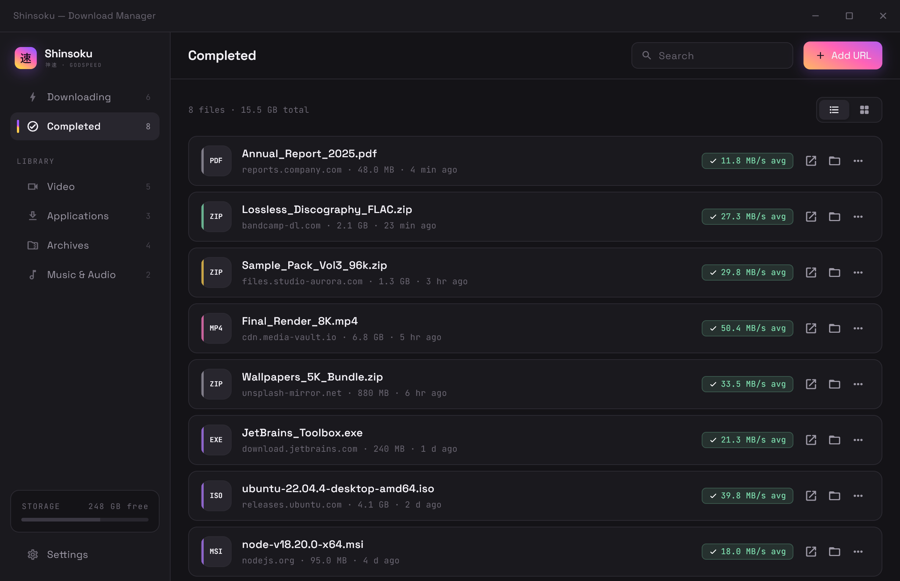
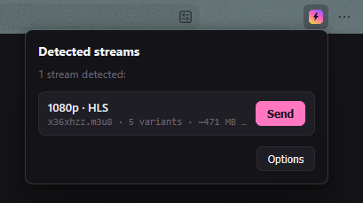
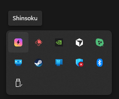
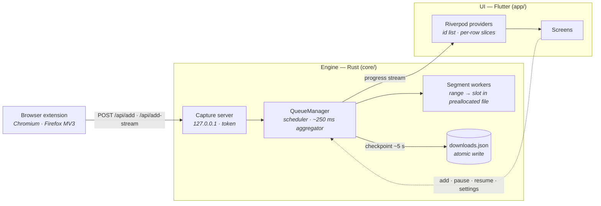

<p align="center">
  
</p>

<h1 align="center">Shinsoku</h1>

<p align="center">
  <em>神速 — godspeed.</em>
</p>

<p align="center">
  A fast, open-source download manager. Multi-segment parallel downloads, exact resume,
  HLS video capture and a browser extension, on a Rust engine with a Flutter UI.
</p>

<p align="center">
  <a href="https://github.com/Purukitto/Shinsoku/actions/workflows/ci.yml"></a>
  <a href="https://github.com/Purukitto/Shinsoku/releases/latest"></a>
  <a href="LICENSE"></a>
  
</p>

<!-- SEO: free open source download manager, fast multi-threaded download accelerator for
     Windows, IDM alternative, m3u8 / HLS video downloader, Flutter Rust desktop app -->

---

Shinsoku splits every download into parallel byte-range segments and writes each one
straight into its slot of a preallocated file, so a single transfer can use the whole
connection instead of whatever one TCP stream manages. Pause it, quit, reboot: it picks
up from the exact byte each segment reached.

The engine is Rust — `tokio`, `reqwest`, one shared connection pool, streaming I/O with
no whole-file buffering — and it owns all download state. The Flutter UI is a thin view
over it, bridged with [`flutter_rust_bridge`](https://github.com/fzyzcjy/flutter_rust_bridge).
A companion browser extension hands downloads over with the cookies, referrer and
User-Agent the browser would have used, so links behind a login still work.

> Windows is the shipping target. Android and Linux share the Flutter UI but their
> native engine build is not wired yet — see [Not built yet](#not-built-yet).

## Screenshots

<div align="center">


<br/>
<sub>The main window: live throughput, per-segment progress and the active queue.</sub>

<br/><br/>

<table>
  <tr>
    <td width="50%" align="center" valign="top">
      <br/>
      <sub><b>Detail</b> — segment map, speed history and checksum</sub>
    </td>
    <td width="50%" align="center" valign="top">
      <br/>
      <sub><b>Add</b> — URL probe, request headers and expected digest</sub>
    </td>
  </tr>
  <tr>
    <td align="center" valign="top">
      <br/>
      <sub><b>Settings</b> — connections, speed limit, off-peak and pairing</sub>
    </td>
    <td align="center" valign="top">
      <br/>
      <sub><b>Completed</b> — history, sorted into category folders</sub>
    </td>
  </tr>
  <tr>
    <td align="center" valign="top">
      <br/>
      <sub><b>Extension</b> — detected streams, one click to send</sub>
    </td>
    <td align="center" valign="top">
      <br/>
      <sub><b>Tray</b> — keeps running with the window closed</sub>
    </td>
  </tr>
</table>

</div>

## Download

Grab the build from the [latest release](https://github.com/Purukitto/Shinsoku/releases/latest):

| File | What it is |
| --- | --- |
| `Shinsoku-x.y.z-windows-x64.zip` | The app. Unzip anywhere and run `shinsoku.exe` — there is no installer yet. |
| `Shinsoku-Capture-x.y.z-chromium.zip` | Browser extension for Chrome, Edge and Brave. |
| `Shinsoku-Capture-x.y.z-firefox.zip` | Browser extension for Firefox. |
| `SHA256SUMS.txt` | Checksums for all of the above. |

Windows 10 or 11, x64. Like any Flutter desktop app it needs the Microsoft Visual C++
runtime, which almost every machine already has; if `shinsoku.exe` complains about a
missing `MSVCP140.dll`, install the
[Visual C++ Redistributable](https://learn.microsoft.com/cpp/windows/latest-supported-vc-redist).

The binaries are unsigned, so SmartScreen warns on first launch — **More info → Run
anyway**. To check what you downloaded against the release:

```powershell
Get-FileHash .\Shinsoku-x.y.z-windows-x64.zip -Algorithm SHA256
```

### Updating

Once per launch Shinsoku asks GitHub for this repository's latest published release.
If it is newer than what is running, the version line at the foot of the sidebar turns
into **Update available vX.Y.Z**; clicking it opens the release page. Nothing downloads
or installs itself.

To update, quit Shinsoku, unzip the new release over the old folder or next to it, and
run the new `shinsoku.exe`. The download list, history and settings live
in `%APPDATA%\io.shinsoku\shinsoku`, not beside the exe, so they carry over.
Unfinished downloads come back paused and resume from where they stopped.

What changed in each version is in [CHANGELOG.md](CHANGELOG.md) — the release notes
are that file's section for the version, word for word. If the check fails because you
are offline or rate-limited, the sidebar just shows the current version.

## Using it

**Add** — or copy a link while **Clipboard monitor** is on and accept the banner —
probes the URL for its name and size, then queues it. **Advanced** in the Add dialog
takes extra request headers and an expected checksum.

| Setting | Does |
| --- | --- |
| Connections | Most segments one download may open, 1–16 (default 8). The Add dialog picks each download's count within it. |
| Simultaneous | Downloads running at once, 1–8 (default 3). The rest wait in the queue. |
| Download limit | One global speed cap shared by every download. 0 is unlimited. |
| Off-peak | Lifts the limit inside a daily window (default 23:00–07:00, wraps past midnight). |
| Categorize | Sorts finished files into `Videos`, `Images`, `Documents`, `Music`, `Programs`, `Compressed` or `Other`. |
| Clipboard monitor | Offers to download a copied `http(s)` link. |
| Browser integration | Starts the capture server the extension talks to. Off until you turn it on. |

A download whose name is already taken saves as `file (2).ext` rather than overwriting.
Every finished file is hashed — SHA-256, or MD5 if that is what you gave as the
expected digest (the two are told apart by length) — and with an expected digest the
detail screen shows **VERIFIED** or **MISMATCH**.

Minimise hides Shinsoku to the tray, where downloads keep running. Closing the window,
or **Quit** in the tray menu, exits.

### Browser extension

The extension intercepts downloads in Chromium browsers and Firefox and posts them to
the app with the site's cookies, referrer and User-Agent; only once the app accepts
does it cancel the browser's own download, so with Shinsoku closed nothing is lost. It
also watches for HLS playlists and counts them on its toolbar icon — click it and
**Send** a stream to download it as one file.

Turn on **Settings → Capture → Browser integration**, copy the pairing code, paste it
into the extension's options. Full instructions, including Firefox's host-permission
step, are in [extension/README.md](extension/README.md).

### HLS streams

Paste an `.m3u8` link into Add, or send one from the extension. Shinsoku picks the
highest-bitrate variant, downloads segments with bounded concurrency, decrypts AES-128,
and joins them in order into a single `.ts` — or `.mp4` when the stream is fragmented
MP4. Video on demand only: a playlist without `#EXT-X-ENDLIST` is a live stream and is
refused rather than recorded forever.

## Privacy

Shinsoku has no telemetry, no analytics and no account. It makes two kinds of network
request: the downloads you ask for, and the update check — one `GET` to
`api.github.com` per launch, carrying nothing but the User-Agent `Shinsoku-UpdateCheck`.
Fonts are bundled.

Three things are worth stating plainly:

- **What is stored.** `%APPDATA%\io.shinsoku\shinsoku\downloads.json` holds the download
  list and up to 500 finished items: URLs, file paths and **any request headers attached
  to a download, including cookies the extension forwarded, in plain text**.
  `settings.json` holds settings and `capture.json` the pairing token. Delete the
  folder to reset Shinsoku.
- **The capture server.** It listens on `127.0.0.1` only (port 7878 unless taken), and
  refuses any request without the pairing token. It sends no CORS headers, so web pages
  cannot call it; only the extension, through its host permission, can.
- **The clipboard.** Read only while **Clipboard monitor** is on, and only checked for a
  single `http(s)` URL. Nothing read leaves the machine.

## Building from source

| Tool | Version | Notes |
| --- | --- | --- |
| [Flutter SDK](https://docs.flutter.dev/get-started/install) | stable, Dart 3.12+ | `flutter config --enable-windows-desktop` |
| [Rust](https://rustup.rs) | stable | `cargo` must be on `PATH` or in `~/.cargo/bin` |
| Visual Studio 2022 | — | the **Desktop development with C++** workload |
| [`flutter_rust_bridge_codegen`](https://cjycode.com/flutter_rust_bridge/) | 2.9.0 | only to change the bridge API: `cargo install flutter_rust_bridge_codegen --version 2.9.0` |

```bash
git clone https://github.com/Purukitto/Shinsoku.git
```

```bash
cd Shinsoku/app && flutter pub get
```

```bash
flutter run -d windows --release
```

The Windows CMake build runs `cargo build --release` on `core/` and bundles
`shinsoku_core.dll` next to the exe, so there is no separate engine step.
`flutter build windows --release` leaves a portable build in
`app/build/windows/x64/runner/Release/`.

<details>
<summary><strong>Judge speed in release, not debug</strong></summary>

The engine is always compiled in release, even under `flutter run` in debug, so
throughput is real either way. The UI is not: debug Flutter is JIT-compiled with
assertions on, and its frame times say nothing about the shipped app. Anything about
rendering or responsiveness has to be checked with `--profile` or `--release`.

</details>

### Commands

| Where | Command | Does |
| --- | --- | --- |
| `app/` | `flutter run -d windows --release` | Run the app |
| `app/` | `dart format .` · `flutter analyze` · `flutter test` | Format, lints and widget tests |
| `app/` | `flutter_rust_bridge_codegen generate` | Regenerate the bindings after changing `core/src/api.rs` |
| `core/` | `cargo test` | Engine unit tests and integration tests against a local range server |
| `core/` | `cargo fmt --all` · `cargo clippy --all-targets -- -D warnings` | Format and lint, as CI does |
| root | `./tool/screenshots.ps1` | The real app on deterministic mock data; F1–F6 write the gallery PNGs |
| root | `./extension/build.ps1` | Assemble `extension/dist/chromium` and `dist/firefox` |
| root | `./tool/check-version.ps1` | Check every manifest carries the same version |
| root | `./tool/bump-version.ps1 X.Y.Z` | Cut a release — see [CONTRIBUTING.md](CONTRIBUTING.md#releasing) |

## Architecture



The engine owns every byte of download state. A ~250 ms aggregator reads per-segment
atomics, works out speed, re-checks the off-peak window, checkpoints to disk and pushes
one progress event across the bridge. On the Dart side a light tick patches the one
row that changed; only a structural change — a status flip, a size first known —
refetches the list. The list watches an ordered id list and each row its own item, so
a tick never rebuilds the whole screen.

### Where things are

| Path | What |
| --- | --- |
| `core/src/api.rs` | The only module the bridge scans: engine handle, control functions, progress stream |
| `core/src/queue/manager.rs` | `QueueManager` — scheduling, aggregation, off-peak, HLS, persistence |
| `core/src/engine/orchestrator.rs` | Probe a URL and split it into byte-range segments |
| `core/src/engine/worker.rs` | Stream one range into its slot, rate-limited and resumable |
| `core/src/protocols/hls.rs` | Playlist parsing, variant choice, AES-128 |
| `core/src/storage/` | Partial files, atomic JSON store, streaming SHA-256 / MD5 |
| `core/src/capture/mod.rs` | Loopback server the extension posts to |
| `core/tests/download.rs` | Integration tests against a hermetic range server |
| `app/lib/src/providers/downloads_provider.dart` | Where Rust state becomes UI state |
| `app/lib/src/providers/settings_provider.dart` | Pushes engine-side settings, debounces the save |
| `app/lib/src/services/version_service.dart` | The update check |
| `app/lib/src/ui/desktop/` | Shell, screens and the Add dialog |
| `app/lib/main_screenshots.dart` | Mock-data harness behind the screenshots |
| `app/lib/src/rust/`, `core/src/frb_generated.rs` | Generated bindings — never edited by hand |
| `extension/shared/` | Extension source; `build.ps1` assembles `dist/` from it |
| `tool/` | Versioning, release and screenshot scripts |

Design decisions — engine-side persistence, the loopback capture server, how HLS
progress reuses the byte fields — are recorded in [docs/decisions.md](docs/decisions.md).

## Not built yet

- Android and Linux builds. The Flutter targets exist; the native engine build is wired
  for Windows only.
- An installer, and code signing so SmartScreen stops warning.
- Store listings for the extension. Chromium loads it unpacked in developer mode;
  Firefox loads it as a temporary add-on, which it forgets on restart.
- Automatic retry. A failed download stops with its error and waits for you.
- Queue priorities and per-download speed limits. Every download shares one global
  limit.
- FTP and BitTorrent. **Cap upload / seeding** in Settings is saved but has no effect
  until there is something to seed.
- Live HLS, DASH, `SAMPLE-AES`, and remuxing `.ts` into `.mp4`.
- `blob:` and `data:` downloads cannot be captured — the bytes only exist inside the
  page — so the extension lets the browser save those itself.

## Contributing

[CONTRIBUTING.md](CONTRIBUTING.md) covers setup, the checks CI runs, commit messages,
the changelog and how a release is cut. Security issues go through
[SECURITY.md](SECURITY.md), not the issue tracker.

## Licence

[GPL-3.0](LICENSE) © Pulkit Sambhavi Singh

Fonts: [Space Grotesk](https://fonts.google.com/specimen/Space+Grotesk) and
[JetBrains Mono](https://www.jetbrains.com/lp/mono/), both under the SIL Open Font
Licence.
