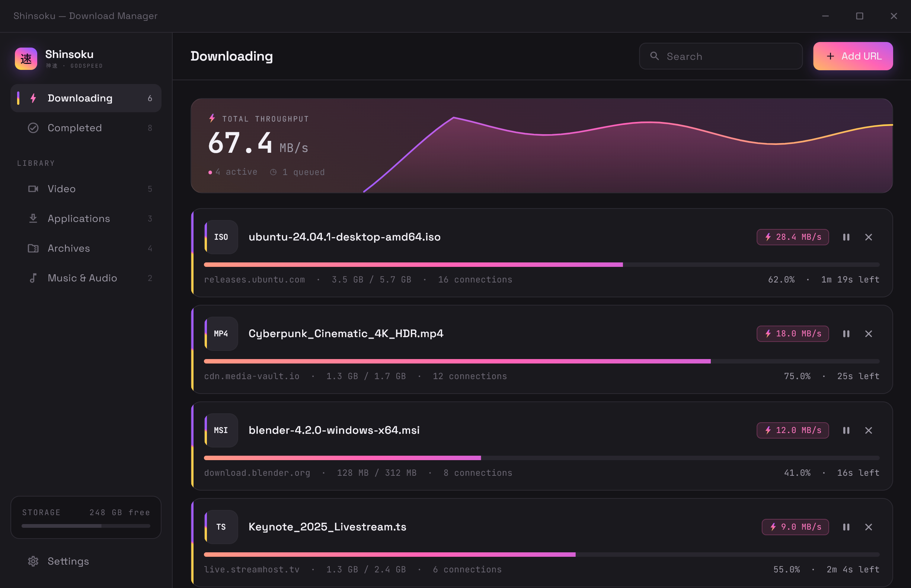

<div align="center">


# Shinsoku

### 神速 — *godspeed.* A blazing-fast, open-source download manager.

Multi-segment parallel downloads, resume, queueing, HLS video capture, and a browser
extension — powered by a **Rust** engine with a **Flutter** UI.

<!-- SEO: free open source download manager, fast multi-threaded download accelerator for
     Windows, IDM alternative, m3u8 / HLS video downloader, Flutter Rust desktop app -->

[](LICENSE)
[](#-roadmap)
[](core/)
[](app/)
[](CONTRIBUTING.md)
[](https://github.com/purukitto/Shinsoku/stargazers)

[Features](#-features) · [Screenshots](#-screenshots) · [Download](#-download) · [Build from Source](#%EF%B8%8F-build-from-source) · [Browser Extension](#-browser-extension) · [Architecture](#-architecture) · [Roadmap](#-roadmap) · [Contributing](#-contributing)

</div>

---

## What is Shinsoku?

**Shinsoku** (Japanese 神速, *"godspeed"*) is a **fast, free, open-source download manager**
for the desktop. It splits every download into many parallel byte-range segments to
saturate your connection, resumes cleanly after interruptions, manages a prioritized
queue, verifies file integrity, and can grab **HLS (`.m3u8`) video streams** as a single
file. A companion **browser extension** hands off downloads — cookies, referrer and
User-Agent included — so logged-in and gated links just work.

The download engine is written in **Rust** for true thread-level parallelism and
zero-copy streaming I/O; the interface is built once in **Flutter** for Windows, Android,
and Linux. The two are bridged with type-safe async bindings via
[`flutter_rust_bridge`](https://github.com/fzyzcjy/flutter_rust_bridge).

> **Status:** Windows is the primary, actively-developed target. Android and Linux build
> wiring is in progress — see the [roadmap](#-roadmap).

---

## ✨ Features

- ⚡ **Multi-segment parallel downloading** — configurable connections (default 8–16) with
  per-segment byte-range requests to maximize throughput.
- ⏯️ **Pause & resume** — exact byte-accurate resume using HTTP range requests; survives
  app restarts.
- 📋 **Download queue & priorities** — control how many downloads run at once and in what
  order.
- 🎚️ **Bandwidth throttling** — global and per-download speed limits.
- 🌙 **Off-peak acceleration** — automatically lifts the speed cap during a window you
  define (re-evaluated live, wraps past midnight).
- 🔁 **Auto-retry** — transient failures are retried automatically.
- 🔐 **Integrity verification** — streaming **SHA-256 / MD5** check after completion; paste
  an expected digest and Shinsoku verifies it (algorithm inferred from digest length).
- 🎬 **HLS video capture** — parses `.m3u8` playlists, picks the highest-bitrate variant,
  downloads segments with bounded concurrency, **AES-128 decrypts**, and concatenates to a
  single `.ts`/`.mp4` file (VOD).
- 🧩 **Browser extension** — Chromium (Chrome/Edge/Brave) and Firefox MV3 capture with a
  token-protected loopback handshake; forwards cookies, referrer and User-Agent.
- 📎 **Clipboard monitoring** — copy a link and Shinsoku offers to grab it.
- 🗂️ **Auto-categorize** — sort completed files by type.
- 🔔 **Update checker** — tells you in-app (sidebar) when a newer GitHub release is available
  and links straight to it.
- 🖥️ **Native desktop polish** — system tray, custom frameless window, bundled fonts, dark
  "voltage" theme.

---

## 📸 Screenshots

<div align="center">


<br/>
<sub>The main window — live throughput graph, multi-segment progress bars and the active queue.</sub>

<br/><br/>

<table>
  <tr>
    <td width="50%" align="center" valign="top">
      <br/>
      <sub><b>Active downloads</b> — live speeds, ETAs & per-segment progress</sub>
    </td>
    <td width="50%" align="center" valign="top">
      <br/>
      <sub><b>Download detail</b> — segment map, speed chart & integrity check</sub>
    </td>
  </tr>
  <tr>
    <td align="center" valign="top">
      <br/>
      <sub><b>Add a download</b> — URL probe, custom headers & expected hash</sub>
    </td>
    <td align="center" valign="top">
      <br/>
      <sub><b>Settings</b> — connections, throttle, off-peak & browser pairing</sub>
    </td>
  </tr>
  <tr>
    <td colspan="2" align="center" valign="top">
      <br/>
      <sub><b>Completed</b> — finished, categorized download history</sub>
    </td>
  </tr>
  <tr>
    <td align="center" valign="top">
      <br/>
      <sub><b>Browser extension</b> — HLS stream detection with one-click send</sub>
    </td>
    <td align="center" valign="top">
      <br/>
      <sub><b>System tray</b> — runs in the background with quick controls</sub>
    </td>
  </tr>
</table>

</div>

---

## 🚀 Download

**Just want to use Shinsoku?** Grab the latest Windows build — no toolchain required.

➡️ **[Download the latest release](https://github.com/purukitto/Shinsoku/releases/latest)**

1. Download `Shinsoku-vX.Y.Z-windows-x64.zip` from the release assets.
2. Unzip it anywhere and run **`shinsoku.exe`** (portable — no installer yet).
3. *(Optional)* Grab `chromium.zip` / `firefox.zip` from the same release for the
   [browser extension](#-browser-extension).

Shinsoku checks the release feed on launch and tells you in the sidebar when a newer
version is available, linking straight to the download.

> **Windows SmartScreen** may warn on first run because the build isn't code-signed yet —
> choose *More info → Run anyway*. Android and Linux builds are not published yet
> (see the [roadmap](#-roadmap)).

---

## 🛠️ Build from Source

For developers and power users who want to build, hack on, or run the latest `main`.

### Prerequisites

| Tool | Version | Notes |
|---|---|---|
| [Flutter SDK](https://docs.flutter.dev/get-started/install) | 3.12+ (Dart 3.12) | enable desktop: `flutter config --enable-windows-desktop` |
| [Rust toolchain](https://rustup.rs/) | stable | `rustup` recommended |
| [`flutter_rust_bridge_codegen`](https://cjycode.com/flutter_rust_bridge/) | 2.9.0 | only needed if you change the Rust API: `cargo install flutter_rust_bridge_codegen --version 2.9.0` |
| Visual Studio 2022 | — | "Desktop development with C++" workload (Windows builds) |

### Clone, run & build (Windows)

```bash
git clone https://github.com/purukitto/Shinsoku.git
cd Shinsoku/app

# Fetch Dart deps
flutter pub get

# Run the desktop app (release recommended for real performance)
flutter run -d windows --release

# …or produce a distributable build (output: app/build/windows/x64/runner/Release/)
flutter build windows --release
```

The Rust engine in [`core/`](core/) is compiled automatically as part of the Flutter
build via `flutter_rust_bridge` — you don't build it separately.

### Regenerating the bridge

If you change the Rust API surface in `core/src/api.rs`, regenerate the Dart bindings
(run in `app/`):

```bash
flutter_rust_bridge_codegen generate
```

> ⚠️ Files under `app/lib/src/rust/` and `core/src/frb_generated.rs` are **auto-generated** —
> don't hand-edit them.

### Running tests

```bash
# Rust engine tests
cd core && cargo test

# Flutter analyzer + tests
cd app && flutter analyze && flutter test
```

### Cutting a release

Maintainers bump versions in lockstep and tag — the
[release workflow](.github/workflows/release.yml) then builds the Windows app + extension
and publishes a GitHub Release:

```bash
pwsh tool/bump-version.ps1 X.Y.Z   # bumps app + core + extension, rolls CHANGELOG
git push && git push --tags        # pushing the vX.Y.Z tag triggers the build
```

---

## 🧩 Browser Extension

Shinsoku ships a browser extension (Chromium + Firefox MV3) that intercepts browser
downloads and forwards them — **with the cookies, referrer and User-Agent** the browser
would have used — to the running app, so authenticated and referrer-gated downloads work.
It also detects **HLS video streams** and lets you send them to Shinsoku from the toolbar.

It talks to a tiny **token-protected loopback HTTP server** hosted by the app (no native
messaging, no per-browser manifest install) and pairs with a single code.

➡️ **Build, install & pairing instructions:** [`extension/README.md`](extension/README.md)

---

## 🏗️ Architecture

Shinsoku is a **monorepo**: a Rust engine, a Flutter UI, and a browser extension.

```
Shinsoku/
├── app/          # Flutter UI — Windows, Android, Linux (single codebase)
│   └── lib/src/
│       ├── rust/        # auto-generated flutter_rust_bridge bindings (do not edit)
│       ├── ui/          # screens & widgets (desktop shell, detail, settings…)
│       ├── providers/   # Riverpod state (downloads, settings, capture)
│       └── services/    # settings, capture, tray
├── core/         # Rust download engine (libshinsoku)
│   └── src/
│       ├── engine/      # multi-segment download, worker, throttle, orchestrator
│       ├── queue/       # queue, scheduler, off-peak manager
│       ├── protocols/   # HTTP/HTTPS + HLS (m3u8)
│       ├── storage/     # partial files, assembly, atomic store, integrity
│       └── capture/     # loopback server for the browser extension
├── extension/    # Chromium + Firefox MV3 capture extension
├── docs/         # screenshots & assets (logo, icon)
└── packages/     # shared Dart/Flutter packages (UI kit)
```

**Design principles**

- **All download logic lives in Rust.** The UI never re-implements engine behavior; it
  watches narrow state slices through Riverpod so rebuilds stay tight.
- **Engine-owned persistence.** The download list + history serialize to a single atomic
  JSON file (temp + rename) written by the Rust core. App settings live in a separate
  app-side JSON.
- **Performance is a first-class requirement** — see the perf rules in [`CLAUDE.md`](CLAUDE.md).

Key architecture decisions (persistence, capture server, integrity, off-peak, HLS) are
recorded under **Resolved Decisions** in [`CLAUDE.md`](CLAUDE.md).

---

## 🗺️ Roadmap

| Platform | Status |
|---|---|
| **Windows** | ✅ Primary target — engine + UI wired end-to-end |
| **Android** | 🚧 Build wiring in progress |
| **Linux** | 🚧 Planned (Flutter Linux is mature; low incremental cost) |
| macOS / iOS | ❌ Out of scope for now |

| Capability | Status |
|---|---|
| Multi-segment HTTP/HTTPS downloads | ✅ |
| Pause / resume / auto-retry | ✅ |
| Queue, priorities & throttling | ✅ |
| Off-peak acceleration | ✅ |
| Integrity check (SHA-256 / MD5) | ✅ |
| Browser capture (cookies/referrer/UA) | ✅ |
| HLS / m3u8 capture (AES-128, VOD) | ✅ |
| Packaging / installers | 🚧 |
| CI/CD release pipeline | ✅ tag-triggered Windows build + GitHub Release |
| FTP, magnet / torrent | 💡 Future |
| Live HLS / DASH / SAMPLE-AES | 💡 Future |

Legend: ✅ done · 🚧 in progress · 💡 idea / future

---

## 🛠️ Tech Stack

| Layer | Choice | Why |
|---|---|---|
| Engine | **Rust** + `tokio` + `reqwest` (rustls) | true thread parallelism, zero-copy streaming, production HTTP |
| UI | **Flutter** | one codebase for Windows, Android, Linux |
| Bridge | **`flutter_rust_bridge` v2** | type-safe async Dart ↔ Rust bindings |
| State | **Riverpod** | narrow, performant state slices |
| Integrity | `sha2`, `md-5` | streaming hashing |
| HLS crypto | `aes`, `cbc` | AES-128 segment decryption |
| Capture server | `axum` | tiny token-guarded loopback API |
| Persistence | atomic JSON (engine) | no DB dependency; survives restarts |

---

## 🤝 Contributing

Contributions are very welcome — bug reports, features, docs and tests!

- Read the [Contributing Guide](CONTRIBUTING.md) for setup, workflow and code conventions.
- Be kind: this project follows a [Code of Conduct](CODE_OF_CONDUCT.md).
- Found a vulnerability? See the [Security Policy](SECURITY.md).

Good first contributions: Android/Linux build wiring, packaging/installers, and
code-signing the Windows release.

---

## 🔒 Security

The browser-capture loopback server binds to `127.0.0.1` and is guarded by a pairing
token. Please report security issues privately — see [SECURITY.md](SECURITY.md).

---

## 📄 License

Shinsoku is licensed under the **GNU General Public License v3.0**. See [LICENSE](LICENSE).

This means you're free to use, study, share and modify it — but derivative works that you
distribute must also remain open source under the GPL.

---

## 🙏 Acknowledgements

- [`flutter_rust_bridge`](https://github.com/fzyzcjy/flutter_rust_bridge) — the FFI bridge that makes this architecture possible.
- [`reqwest`](https://github.com/seanmonstar/reqwest), [`tokio`](https://tokio.rs/), [`axum`](https://github.com/tokio-rs/axum) and the broader Rust async ecosystem.
- [Riverpod](https://riverpod.dev/) for Flutter state management.
- Fonts: [Space Grotesk](https://fonts.google.com/specimen/Space+Grotesk) and [JetBrains Mono](https://www.jetbrains.com/lp/mono/) (SIL Open Font License).

<div align="center">
<br/>
<sub>Built with ⚡ and Rust. If Shinsoku is useful to you, consider leaving a ⭐.</sub>
</div>
